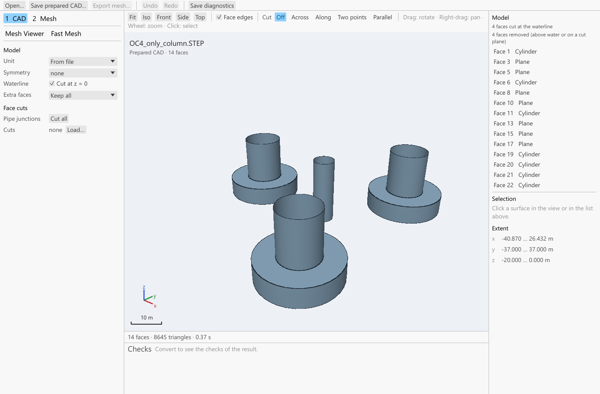
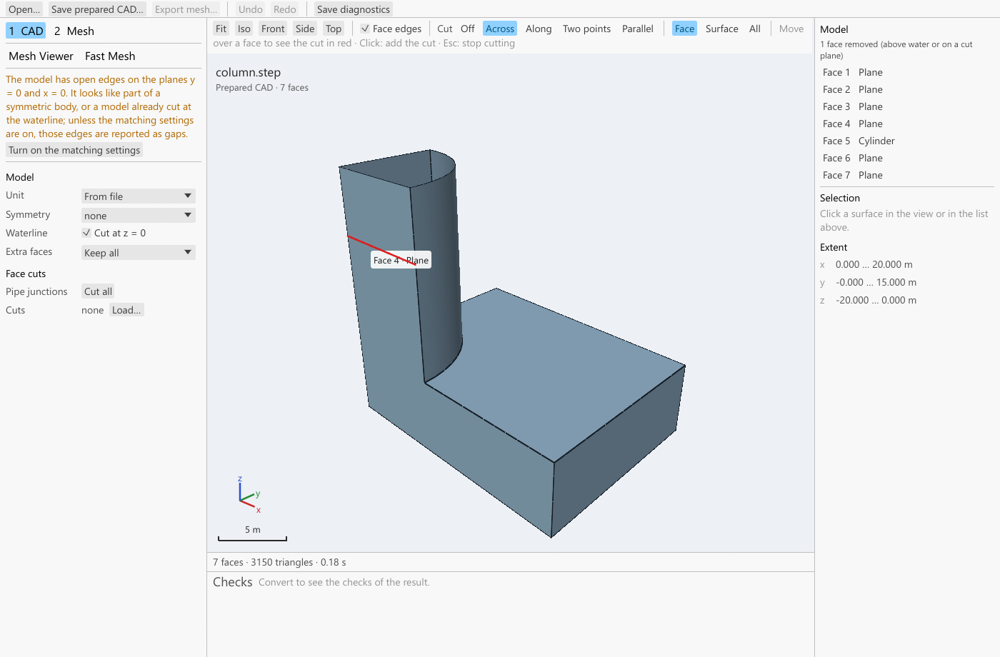
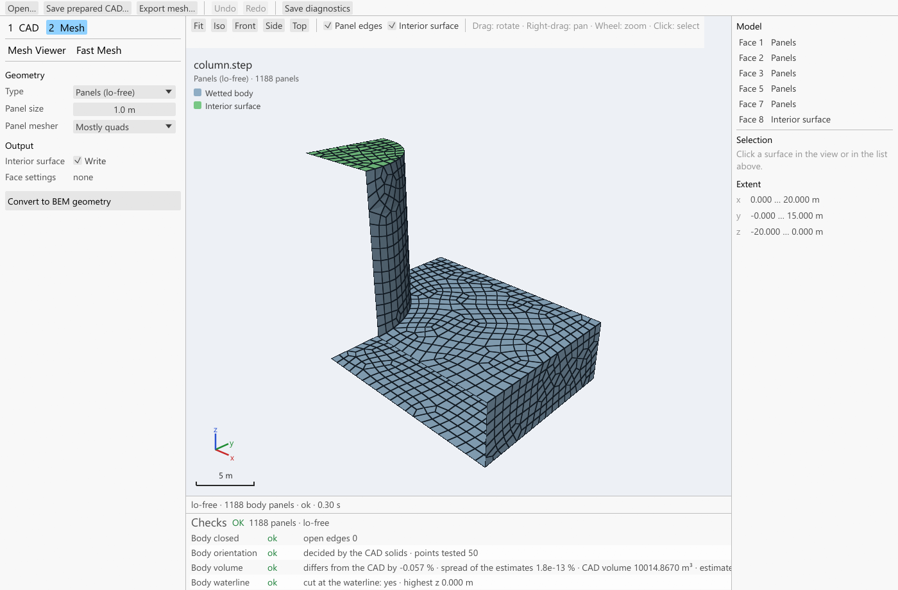
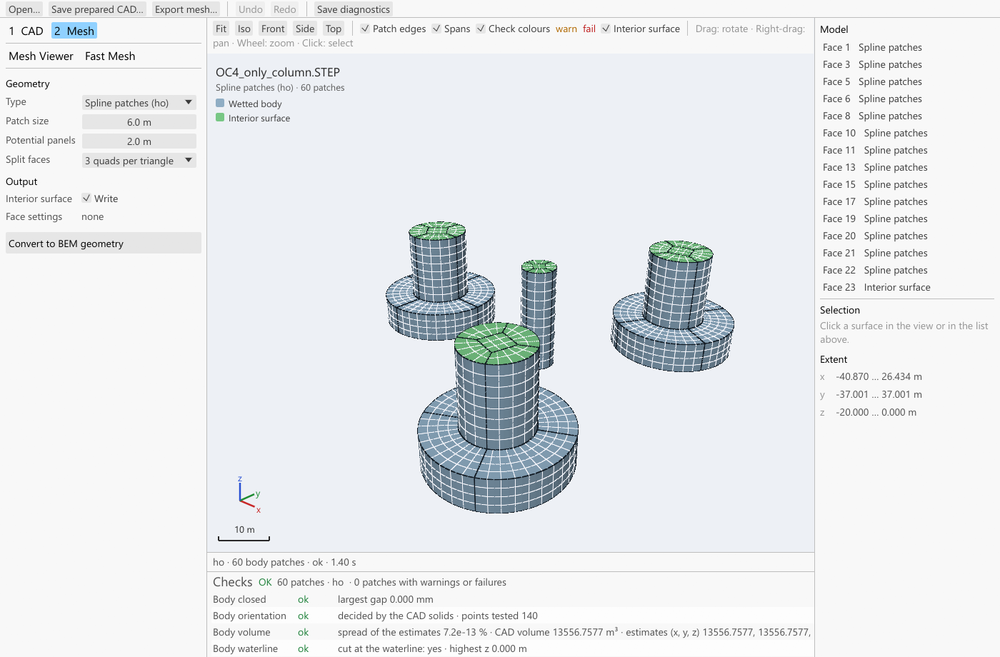
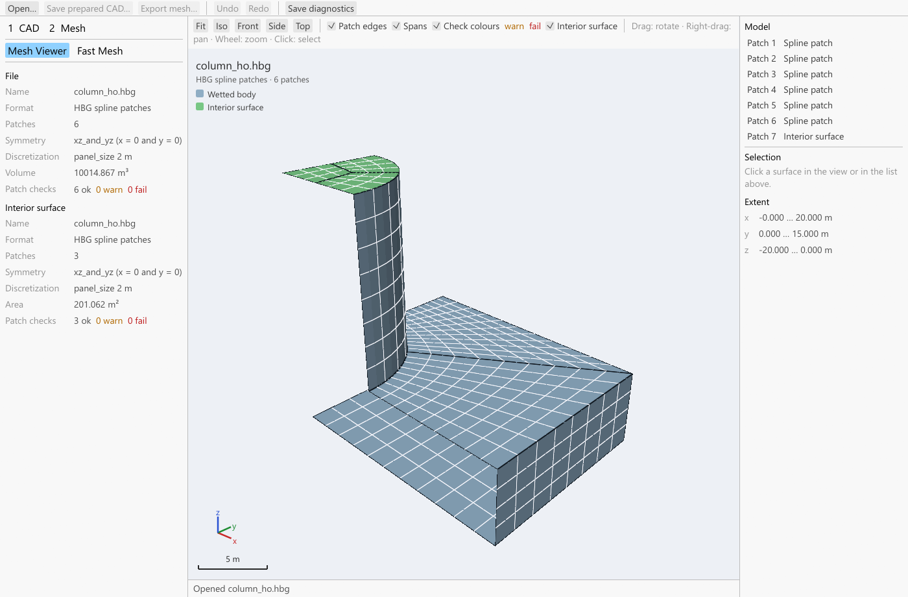
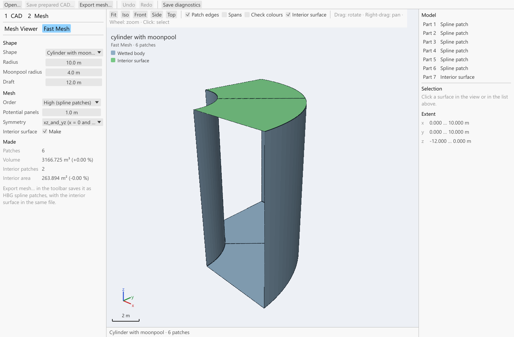

# GUI manual

This manual walks through the cad2bem window: preparing a CAD model, converting it to BEM geometry, checking and
exporting the result, viewing geometry files and making simple bodies without CAD. What the conversion does
(modes, units, symmetry, checks, file formats) is in the [user guide](user-guide.md); every option has a command
line twin in the [command line reference](reference/cli.md).

## 1. Starting

Open `cad2bem.exe` from Explorer, drop a CAD file on its icon, or run `cad2bem gui` (`cad2bem gui --open FILE`
opens a file at once). **Open…** in the toolbar, or dropping a file on the window, opens:

- a CAD file (STEP `.step`/`.stp`, IGES `.iges`/`.igs`): it is prepared and shown in the **1 CAD** tab;
- a BEM geometry file (HBG `.hbg` version 3, GDF `.gdf` or the `.spl` of a higher-order GDF, STL `.stl`): it is
  shown in the **Mesh Viewer** tab.

Opening another CAD file starts again from the default settings (no cuts, face settings or symmetry carry over).

## 2. The window

| Area | What it holds |
|---|---|
| Toolbar | **Open…**, **Save prepared CAD…**, **Export mesh…** · **Undo**, **Redo** · **Save diagnostics** |
| Left panel | The tabs (**1 CAD**, **2 Mesh**; under them **Mesh Viewer**, **Fast Mesh**) and the settings of the shown tab |
| View bar | Camera buttons, display switches and, in the CAD tab, the cut mode |
| View | The model; in its top left corner the file, what is shown and, with the interior surface on, the colour legend |
| Status line | Under the view: the running job (with **Cancel**), the last result or error |
| Checks | Under the status line, after a conversion: the body checks and the patches with warnings or failures |
| Right panel | **Model**: the faces or groups (click one to select it); **Selection** with its face settings; **Extent** |

Drag the edge of a side panel to widen it. Long names are cut short and shown in full when the mouse is over them.

### Moving the view

| Mouse or key | Action |
|---|---|
| Left drag | Orbit about the surface point under the cursor |
| Right drag | Pan (the grabbed point stays under the cursor) |
| Wheel | Zoom toward the surface under the cursor |
| Click | Select the face under the cursor (in the cut mode: add the cut) |
| **Fit**, **Iso**, **Front**, **Side**, **Top** | Fit the model, or look along a fixed direction |
| Ctrl+Z, Ctrl+Y (or Ctrl+Shift+Z) | Undo, redo a settings change |
| Esc | Leave the cut mode (in **Parallel**: pick another reference) |

The camera stays where it was across conversions, cuts and tab changes. The face under the mouse is drawn
lighter and named next to the cursor; the scale bar is true at the depth of the view centre.

## 3. Step 1: prepare the CAD (1 CAD)

The CAD view always shows the faces the conversion will mesh, after every setting below, and follows each
change within a moment. Its face numbers are those of the converted result.

| Setting | Meaning |
|---|---|
| **Unit** | The unit of the numbers in the file: **From file** (its own statement) or m, mm, cm, ft, in |
| **Symmetry** | Mesh one side only (the solver mirrors it): `xz` (y = 0), `yz` (x = 0), `xz_and_yz` (both), as HBG names them |
| **Waterline** | **Cut at z = 0** keeps the wetted part only (needed for the interior surface) |
| **Extra faces** | **Keep all**, **Remove plates** (pieces with a free edge), **Largest body only** |
| **Pipe junctions: Cut all** | Adds the cuts that pipe ends and walls with pipe holes need for four-sided pieces |
| **Cuts** | The number of face cuts; **Load…**, **Save…** (JSON), **Clear**; **Cut list** removes single cuts |

When the model is open along y = 0, x = 0 or z = 0 (a saved half or quarter model) without the matching
symmetry or waterline cut, the tab says so: **Turn on the matching settings** sets them. **Save prepared CAD…** writes the
prepared faces as a STEP file in metres.

### Cutting faces

Cuts split faces into simpler pieces before meshing (a pipe end into four-sided pieces, say). Pick a cut mode in
the view bar:

| Mode | The cut |
|---|---|
| **Across** | Around a cylinder; horizontal on a wall |
| **Along** | Along a cylinder's axis; vertical on a wall |
| **Two points** | Through two clicked points, square to the face at the first |
| **Parallel** | Click a reference face (a plane or a cylinder), then where to cut; the reference stays for the next cut |

and what it cuts: **Face** (the face under the mouse), **Surface** (every face on that plane or cylinder) or
**All** (every face it passes). The cut under the mouse is drawn in red and snaps to face corners; a click adds
it. The cut face is shown split at once and the exact prepared view follows a moment later. **The next cut waits
until then**: cuts are made one at a time, each seen on the faces it made (the status line says so if you click
too early). **Off** or Esc leaves the mode. A cut renumbers the prepared faces, so face settings are cleared.

## 4. Step 2: convert (2 Mesh)

| Setting | Meaning |
|---|---|
| **Type** | **Panels (lo-free)**: flat panels meshed on each face; **Patch panels (lo-str)**: flat panels on spline patch grids; **Spline patches (ho)**: curved B-spline patches (HBG only) |
| **Patch size** | lo-str and ho: the size of the spline patches |
| **Panel size** | lo-free and lo-str: the size of the panels |
| **Potential panels** | ho: the potential panel size written to the HBG file (`panel_size`); the solver divides each patch into spans of about this size, as **Spans** shows. A new value needs no new conversion |
| **Panel mesher** | lo-free: **Mostly quads**, **Quasi-structured quads**, **All quads** or **Triangles**. When the quasi-structured mesher fails on a model, the conversion uses **Mostly quads** and the status line says so |
| **Split faces** | lo-str and ho: the quad mesher for faces with no four-sided layout (**3 quads per triangle**, **Quasi-structured**, **4 quads per triangle**) |
| **Interior surface: Write** | Also make the interior free surface (the waterplane inside the body); needs the waterline cut |
| **Face settings** | How many faces have their own settings; **Clear** removes them |

**Convert to BEM geometry** runs both steps in the background (**Cancel** in the status line stops it); the tab
shows the result when it is done.

### Face settings

Select a face (click it, or its row under **Model**) to give it its own **Layout** (**Auto**, **Face
parameters**, **One patch**, **Polygon (N quads)**, **O-grid (disc)**, **Ring (annulus)**, **Split into quads**),
its own **Panel size** or **Patch size**, and a **Priority**: on an edge shared by faces of different sizes the
face of the higher priority sets the mesh. The next conversion uses them. For a pipe face, **Cut junction** adds
the junction cuts of that pipe alone.

### Reading the result

| Switch | Shows |
|---|---|
| **Face edges** (CAD tab) | The boundaries of the prepared faces |
| **Panel edges** / **Patch edges** | The element boundaries (display diagonals hidden) |
| **Spans** | ho: how the solver divides each patch at the potential panel size |
| **Check colours** | ho: patches whose checks warn (orange) or fail (red) |
| **Interior surface** | The body with its interior surface: the wetted body blue-grey, the interior surface green (legend in the view corner) |

The **Checks** panel lists the body checks (closed, orientation, volume, waterline, interior) with their
measures, then the patches with warnings or failures; hover a check for its meaning, click a patch to select its face. A
result whose checks fail is shown but cannot be exported.

### Exporting

**Export mesh…** writes the last result. Each file holds the body and, after it, the interior surface (its
elements lie in z = 0, where the solver's interior surface "detect" finds them):

| Format | Holds |
|---|---|
| HBG (`.hbg`) | Panels or spline patches (ho writes HBG only) |
| GDF (`.gdf`) | Low-order panels |
| STL (`.stl`) | Low-order panels as triangles: the whole body (symmetry images included), the interior surface a second solid |

A file that exists is replaced once the save dialog has asked (the command line refuses it).

## 5. Mesh Viewer

The Mesh Viewer shows a geometry file as it is, apart from the CAD and Mesh tabs (which keep their work). Its
table lists the format, count, symmetry, discretization (`panel_size`, rows in the file, or none), the volume
(three estimates with the symmetry copies) and the patch checks; the elements lying in z = 0 are shown as the
interior surface, with its area. **Spans** shows the file's own division. A higher-order GDF file (flat or B-spline
patches) takes its spans from the SPL file of the same name beside it; opening the `.spl` opens its GDF. An STL file
(ASCII or binary) is read as triangles of the whole surface, with no symmetry. Analytic shapes (a GDF with a negative
IGDEF, or HBG analytic patches) are not shown.

## 6. Fast Mesh

Fast Mesh makes a body from its dimensions, without CAD: a **Cylinder**, a **Cylinder with moonpool**, a
**Sphere (submerged)**, a **Hemisphere** or a **Barge (box)**. The body is made again at every change.

| Setting | Meaning |
|---|---|
| **Shape** and its dimensions | Radius, draft, moonpool radius, centre depth, length, beam (m) |
| **Order** | **Low (panels)**: flat panels on the shape's own grid; **High (spline patches)**: exact rational patches (HBG only) |
| **Panel shape** | Low: **Quadrilaterals**, or **Triangles** (each quadrilateral split in two along its shorter diagonal) |
| **Panel size** / **Potential panels** | Low: the panel size; High: the potential panel size written to the file |
| **Symmetry** | The stored part, as in a conversion |
| **Interior surface: Make** | The waterplane inside the waterline (floating bodies) |

**Made** compares the volume and the interior area with the exact values (exact for High). **Export mesh…**
writes the body: HBG, GDF or STL for panels, HBG for patches.

## 7. When something goes wrong

- The status line and the error under it say what failed; a view that fails keeps the file open, so changing the
  settings tries again.
- **Save diagnostics** saves a folder with the settings (`state.json`), the conversion request, the last result,
  the session log, a screenshot and a copy of the CAD file, and copies its path. Send that folder with a line on
  what went wrong; `cad2bem gui --diagnostics FOLDER` opens it again with the same file and settings.
- A build without the static CAD kernel (a development build) needs a Gmsh SDK: **Development: Gmsh SDK** › **Choose SDK library…** in the
  left panel picks it when none is found.
- Every session writes a log, panics included, under `%LOCALAPPDATA%\cad2bem\logs` (Linux:
  `~/.local/state/cad2bem/logs`).
